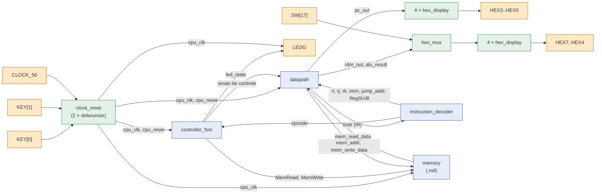
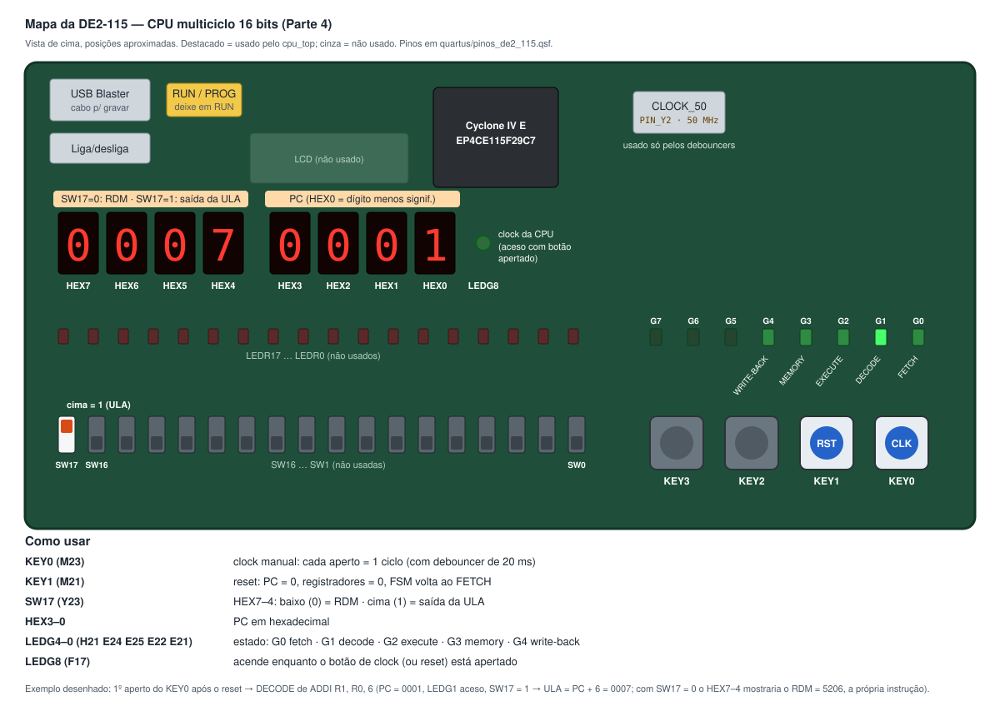

# Descrição e Topologia

## O projeto

CPU multiciclo de 16 bits em VHDL, sintetizada no Quartus e gravada na FPGA da placa DE2-115. Ela executa as 11 instruções do enunciado (`docs/descricao-projeto.md`): ADD, SUB, AND, OR, SLT, ADDI, LD, ST, BEQ, BNE e JMP. O clock é manual, gerado por um botão com debouncer. Os displays e os LEDs da placa mostram o PC, o dado lido da memória ou a saída da ULA, e o estado da unidade de controle.

A base é o processador multiciclo MIPS do Patterson & Hennessy (*Computer Organization and Design*, 2ª ed., cap. 5). O enunciado deixa várias coisas em aberto, e onde o grupo não seguiu o livro está marcado como *(adaptação)* nas seções.

## Por que multiciclo

Cada instrução é dividida em etapas de um ciclo: busca, decodificação, execução, acesso à memória e escrita no registrador. Uma instrução usa só as etapas de que precisa, e por isso leva de 3 a 5 ciclos. Entre um ciclo e o próximo, os resultados ficam em registradores intermediários (IR, RDM, A, B e ALUOut). Com isso, a mesma ULA e a mesma memória são reaproveitadas em ciclos diferentes da mesma instrução.

| Instruções | Ciclos | Estados percorridos |
|---|---|---|
| ADD, SUB, AND, OR, SLT | 4 | FETCH → DECODE → EXEC_R → WB_ALU |
| ADDI | 4 | FETCH → DECODE → ADDR_CALC → WB_ALU |
| LD | 5 | FETCH → DECODE → ADDR_CALC → MEM_READ → WB_MEM |
| ST | 4 | FETCH → DECODE → ADDR_CALC → MEM_WRITE |
| BEQ, BNE | 3 | FETCH → DECODE → BRANCH |
| JMP | 3 | FETCH → DECODE → JUMP |

## Topologia

A CPU tem quatro blocos, ligados somente na entidade de topo (`src/top/cpu_top.vhd`):

| Bloco | Pasta | Função | Seção |
|---|---|---|---|
| Unidade de controle | `src/control/` | Máquina de estados de 10 estados. Recebe o opcode e gera os sinais de controle e o estado para os LEDs. | [04](04-unidade-controle.md) |
| Caminho de dados | `src/datapath/` | PC, banco de registradores, ULA, registradores intermediários e muxes. Executa o que a unidade de controle manda. | [05](05-caminho-dados.md) |
| Memória e decodificador | `src/memory/`, `src/common/` | Memória única de instruções e dados. O decodificador separa os campos da instrução guardada no IR. | — |
| Periféricos da placa | `src/io/` | Debouncer do botão de clock e displays de 7 segmentos. | [abaixo](#integração-na-placa-de2-115) |

Os blocos não se conhecem: cada um só vê as próprias portas. Opcodes e tipos ficam num pacote único (`src/common/cpu_pkg.vhd`), usado por todos.

## Memória

| Decisão | Valor | Motivo |
|---|---|---|
| Topologia | Memória única para instruções e dados, com o mux `IorD` escolhendo o endereço (PC na busca, ALUOut em LD/ST) | Modelo do livro. Usa um único `.mif` por programa, e o RDM mostrado no display sai dela. |
| Tamanho | 4096 palavras de 16 bits (12 bits de endereço) | Igual ao alcance do campo `end` do JMP. Cabe com folga na memória da DE2-115. *(adaptação)* |
| Endereçamento | Por palavra: o PC avança de 1 em 1 | Cada endereço guarda uma instrução inteira de 16 bits. Por isso não existe o "imediato deslocado" do MIPS. *(adaptação)* |
| LD/ST | Usam os 12 bits baixos de `Rj + imediato` | Consequência do tamanho da memória. |
| Implementação | `altsyncram` de porta única, inicializada pelo `.mif`, saída sem registrador, ligada no **clock invertido** | A leitura da RAM do Quartus é síncrona: o endereço é registrado numa borda de clock. Com o clock invertido, o endereço é registrado na borda de descida, e o dado fica pronto antes da próxima borda de subida. Assim, a unidade de controle não precisa de estados de espera em FETCH e MEM_READ. *(adaptação; o livro não trata disso)* |

## Reset

O reset é assíncrono no PC, no banco de registradores, nos registradores intermediários e na unidade de controle, porque vem de um botão físico que não está sincronizado com o clock manual. Depois do reset, todos os registradores valem 0, a execução começa no endereço 0 e a unidade de controle volta para FETCH.

## Integração na placa (DE2-115)

O `cpu_top` liga a CPU aos botões, chaves, displays e LEDs da DE2-115, atendendo os requisitos de teste do enunciado:

| Requisito do enunciado | Como foi atendido | Onde |
|---|---|---|
| Um botão controla o clock, com debouncer | `KEY[0]` → `debouncer` → `clk` da CPU. Cada aperto é um ciclo. | `src/io/debouncer.vhd`, `src/io/clock_reset.vhd` |
| HEX0–HEX3 mostram o PC | 4 instâncias de `hex_display` ligadas a `pc_out` | `src/top/cpu_top.vhd` |
| HEX4–HEX7 mostram o RDM ou a saída da ULA, escolhidos pelo SW17 | `hex_mux` (`SW17 = 0` → RDM, `1` → ULA) + 4 `hex_display` | `src/io/hex_mux.vhd` |
| LEDs verdes indicam o estado da unidade de controle | `LEDG[4:0] = led_state` (one-hot: fetch, decode, execute, memory, write-back) | `src/top/cpu_top.vhd` |
| Memória inicializada por `.mif` | generic `MIF_FILE` do `cpu_top`, repassado à `memory` | `quartus/criar_projeto.tcl` |

Além disso, `KEY[1]` é o reset e `LEDG[8]` acende enquanto o botão de clock está apertado, o que mostra que o debouncer reagiu.

O `cpu_top` é o único arquivo que conhece todos os blocos e não tem lógica própria: só instancia os módulos e liga as portas. Toda a lógica de placa (inverter botões, filtrar quique, decodificar segmentos, escolher o que vai no display) fica em `src/io/`.



A fiação do núcleo (FSM + decodificador + datapath + memória) é a mesma do `sim/testbenches/tb_cpu.vhd`. A integração com a placa acrescenta só o que está em verde.

### Clock da CPU

O **botão é o próprio clock da CPU**: cada aperto é um ciclo, como no Lab05. A alternativa seria rodar a CPU no `CLOCK_50` e usar o botão como enable, que é o mais "correto" em projeto síncrono, mas FSM, datapath e memória teriam de ganhar uma entrada de enable. Com um ciclo por aperto, o aviso do Quartus de clock gerado por lógica não causa problema.

### Módulos de `src/io/`

**`debouncer.vhd`: o botão vira um clock limpo.** Um botão mecânico **quica**: ao ser apertado ou solto, o contato abre e fecha várias vezes durante alguns milissegundos. Como o `KEY[0]` é o próprio clock da CPU, sem filtro cada quique viraria uma borda de subida, e um aperto executaria vários ciclos. O debouncer roda no `CLOCK_50` (50 MHz) e tem três partes:

1. **Sincronizador de 2 flip-flops.** O botão muda a qualquer momento, sem relação com o `CLOCK_50`. Se ele mudar bem na borda, o primeiro FF pode ficar metaestável (nem 0 nem 1). O segundo FF dá um ciclo inteiro para o valor se estabilizar antes de ser usado.
2. **Contador.** Enquanto a entrada sincronizada for igual ao nível estável, o contador fica em 0. Quando ela muda, o contador começa a contar; se o botão voltar antes do fim (quique), o contador zera. Só depois de `CONTAGEM` = 1 000 000 ciclos seguidos (1 000 000 × 20 ns = **20 ms**) o novo nível é aceito. O quique dura poucos milissegundos; 20 ms cobre com folga e é imperceptível para quem aperta.
3. **Inversão.** Os `KEY` da DE2-115 são ativos em 0 (valem 0 apertados). A saída do debouncer é ativa em 1 (`1` = apertado), pronta para ser clock e reset, e a inversão não precisa ficar no topo.

A saída vem de um registrador, então não tem glitch: é seguro usá-la como clock. O `CONTAGEM` é um generic para o testbench poder usar um valor pequeno.

**`clock_reset.vhd`: clock e reset da CPU.** Junta dois debouncers (`KEY[0]` e `KEY[1]`) e entrega `cpu_clk` e `cpu_reset`:

```vhdl
cpu_clk   <= clk_db or reset_db;
cpu_reset <= reset_db;
```

O `or` faz o reset também gerar um pulso de clock. A memória registra o endereço na **descida** do clock (clock invertido, ver [Memória](#memória)); o reset, sendo assíncrono, zera o PC mas não gera borda nenhuma. Com o `or`, apertar o `KEY[1]` sobe o clock, sem efeito porque tudo está em reset; soltar o `KEY[1]` desce o clock junto com o fim do reset, com o PC já em 0, e a memória registra o endereço 0. O problema que isso resolve está em [08](08-dificuldades.md). A correção fica em `src/io/` porque o `cpu_top` não tem lógica e o problema é da interface com os botões, não da memória.

**`hex_display.vhd`: 4 bits → 7 segmentos.** Tabela de 16 linhas (`with ... select`), uma por dígito de 0 a F. Os segmentos da DE2-115 são **ativos em 0** (`0` acende), na ordem `segmentos(0)` = a … `segmentos(6)` = g. As letras b e d saem minúsculas para não serem confundidas com 8 e 0. O mesmo componente é instanciado 8 vezes, uma por display.

**`hex_mux.vhd`: RDM ou ULA nos HEX4–HEX7.** Mux 2:1 de 16 bits: `SW17 = 0` mostra o **RDM** (dado lido da memória) e `SW17 = 1` mostra a **saída da ULA**, na ordem em que o enunciado os cita. A saída da ULA é combinacional, então mostra o que a ULA está calculando **no estado atual** (por exemplo, `PC + 1` no FETCH). O RDM mostra o que foi lido da memória na borda anterior.

**`cpu_top.vhd`: a composição.**
- As portas têm exatamente os nomes e larguras do `quartus/pinos_de2_115.qsf` (`CLOCK_50`, `KEY`, `SW`, `LEDG`, `HEX0`…`HEX7`), porque o Quartus associa os pinos às portas pelo nome.
- Generics `MIF_FILE` (programa carregado na memória) e `DEBOUNCE_CONTAGEM` (20 ms na placa, poucos ciclos na simulação).
- O PC e o dado do display são divididos em fatias de 4 bits (`pc_out(3 downto 0)` vai no HEX0, …, `pc_out(15 downto 12)` no HEX3).
- `LEDG <= cpu_clk & "000" & led_state`: LEDG4–0 = estado, LEDG7–5 apagados, LEDG8 = clock.

### Temporização de um aperto

```
              aperta KEY0          solta KEY0            aperta KEY0
cpu_clk  ______/‾‾‾‾‾‾‾‾‾‾‾‾‾‾‾‾‾‾‾‾\____________________/‾‾‾‾‾‾
               ↑                    ↓                    ↑
               borda de subida:     borda de descida:    borda de subida:
               FSM muda de estado;  memória registra o   IR/RDM capturam o
               PC, IR, A, B,        endereço (PC ou      dado lido
               ALUOut, RDM e banco  ALUOut) e começa
               são escritos         a ler
```

Por isso, olhando a placa: a cada aperto o LED de estado avança, e o PC muda no aperto que sai do FETCH. O valor da memória que aparece no RDM é o do endereço que estava montado quando o botão foi solto.

### Pinagem

Detalhada em [`quartus/pinout.md`](../../quartus/pinout.md) e desenhada em [`quartus/mapa_placa.svg`](../../quartus/mapa_placa.svg). Como compilar e gravar: [`quartus/README.md`](../../quartus/README.md).

| Sinal | Pino | Uso |
|---|---|---|
| `CLOCK_50` | Y2 | só para os debouncers |
| `KEY[0]` | M23 | clock manual da CPU |
| `KEY[1]` | M21 | reset |
| `SW[17]` | Y23 | HEX7–4: 0 = RDM, 1 = ULA |
| `LEDG[0..4]` | E21, E22, E25, E24, H21 | fetch, decode, execute, memory, write-back |
| `LEDG[8]` | F17 | clock da CPU (aceso com o botão apertado) |
| `HEX0..HEX3` | ver `.qsf` | PC |
| `HEX4..HEX7` | ver `.qsf` | RDM ou ULA |


