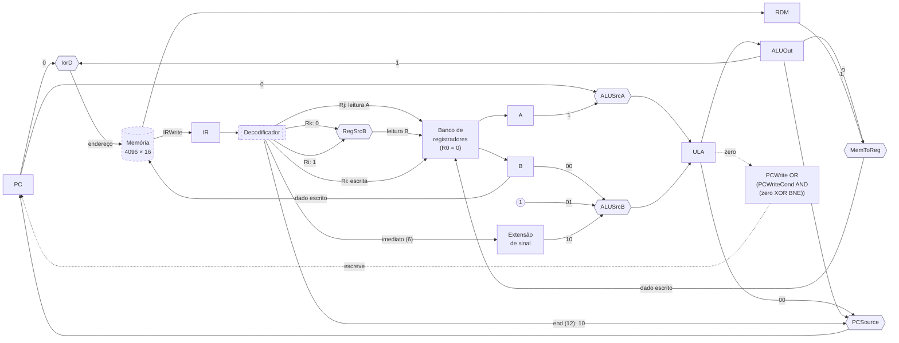

# Caminho de Dados

Responsável: Artur (`src/datapath/`).

## Visão geral

O caminho de dados segue a topologia multiciclo do Patterson & Hennessy (2ª ed., cap. 5), adaptada ao nosso formato de instrução e à FPGA (ver [`decisoes.md`](decisoes.md)). Cada instrução é executada em 3 a 5 ciclos. Os resultados intermediários ficam em registradores entre um ciclo e o próximo, e por isso a mesma ULA e a mesma memória são reaproveitadas em ciclos diferentes:

- **uma memória única** para instruções e dados, endereçada pelo PC (busca) ou pelo ALUOut (LD/ST), escolhidos pelo mux `IorD`;
- **uma ULA**, que calcula `PC+1` no FETCH, o alvo do desvio no DECODE e a operação da instrução no estado de execução;
- **registradores intermediários**: `IR` (instrução), `RDM` (dado lido da memória), `A` e `B` (registradores lidos do banco) e `ALUOut` (resultado da ULA).

O datapath não decide nada. Ele recebe os sinais de controle da FSM (ver [`04-unidade-controle.md`](04-unidade-controle.md)), os campos da instrução do decodificador e o dado lido da memória. Toda a composição está em `src/datapath/datapath.vhd`. A ligação com a FSM, o decodificador e a memória fica em `src/top/cpu_top.vhd`.

## Diagrama

Linhas cheias são dados; linhas tracejadas são a condição de escrita do PC. A memória e o decodificador ficam fora do datapath (contorno tracejado). Os números nas setas que chegam aos muxes são o valor do seletor que escolhe aquela entrada.

## Componentes

| Componente | Arquivo | Função |
|---|---|---|
| PC | `pc.vhd` | Registrador de 16 bits. É escrito quando `PCWrite OR (PCWriteCond AND (zero XOR BNE))`. |
| Banco de registradores | `register_file.vhd` | 8 × 16 bits. Duas leituras combinacionais e uma escrita na borda de subida com `RegWrite`. R0 vale sempre 0. |
| ULA | `alu.vhd` | AND, OR, ADD, SUB e SLT (com sinal), escolhidos pelo `ALUOp` de 3 bits. Gera `zero` quando o resultado é 0. |
| Extensão de sinal | `sign_extend.vhd` | Imediato de 6 bits (−32 a +31) para 16 bits. |
| IR, RDM, A, B, ALUOut | `register_n.vhd` | Registrador genérico. O IR só é escrito com `IRWrite`; os demais são escritos em todo ciclo. |
| Muxes | `mux_n.vhd` | Mux genérico (largura e nº de entradas configuráveis), usado nos 6 pontos de seleção. |

A ULA e o banco de registradores foram adaptados do Lab05. Na ULA, foram removidos NOR, Overflow e Cout, que nenhuma instrução usa. No banco, saíram os valores iniciais fixos de teste e entrou o R0 fixo em 0.

## Muxes

| Seletor | Entradas | Uso |
|---|---|---|
| `IorD` | 0 PC · 1 ALUOut | Endereço da memória: busca da instrução ou LD/ST. |
| `RegSrcB` | 0 Rk · 1 Ri | Leitura B do banco: Rk no tipo R; Ri em ST (dado a gravar) e BEQ/BNE (comparação). |
| `MemToReg` | 0 ALUOut · 1 RDM | Dado escrito em Ri: resultado da ULA (tipo R, ADDI) ou dado lido (LD). |
| `ALUSrcA` | 0 PC · 1 A | Primeiro operando da ULA. |
| `ALUSrcB` | 00 B · 01 constante 1 · 10 imediato estendido | Segundo operando da ULA. |
| `PCSource` | 00 saída da ULA · 01 ALUOut · 10 `end` do JMP | Próximo PC: `PC+1` (calculado no próprio FETCH), alvo do desvio (calculado no DECODE) ou JMP. |

Endereços de registrador fixos: a leitura A é sempre **Rj**, e a escrita é sempre em **Ri**, por isso não existe `RegDst`. O `RegSrcB` é gerado pelo decodificador a partir do opcode, e não pela FSM, porque A e B já são lidos no DECODE.

## Transferências por estado

O que o datapath faz em cada estado da FSM. Os registradores atualizados recebem o valor na borda de subida que encerra o estado.

| Estado | Transferências |
|---|---|
| FETCH | `IR ← M[PC]`, `PC ← PC + 1` |
| DECODE | `A ← R[Rj]`, `B ← R[Rk ou Ri]`, `ALUOut ← PC + ext(imm)` (alvo do desvio, já relativo a PC+1) |
| ADDR_CALC | `ALUOut ← A + ext(imm)` (ADDI, LD, ST) |
| EXEC_R | `ALUOut ← A op B` |
| MEM_READ | `RDM ← M[ALUOut]` |
| MEM_WRITE | `M[ALUOut] ← B` (B = Ri) |
| WB_ALU | `R[Ri] ← ALUOut` |
| WB_MEM | `R[Ri] ← RDM` |
| BRANCH | ULA calcula `A − B`; se `zero XOR BNE`, `PC ← ALUOut` |
| JUMP | `PC ← end` (12 bits, sem sinal) |

## Interface do datapath (`datapath.vhd`)

| Grupo | Portas | Direção | Origem / destino |
|---|---|---|---|
| Relógio | `clk`, `reset` (assíncrono) | entrada | top |
| Controle | `PCWrite`, `PCWriteCond`, `BNE`, `IorD`, `IRWrite`, `MemToReg`, `RegWrite`, `ALUSrcA`, `ALUSrcB(2)`, `ALUOp(3)`, `PCSource(2)` | entrada | FSM |
| Instrução | `ri`, `rj`, `rk` (3 bits), `imm` (6), `jump_addr` (12), `RegSrcB` | entrada | decodificador |
| Instrução | `instr` (conteúdo do IR) | saída | decodificador |
| Memória | `mem_addr` (16; a memória usa os 12 bits baixos), `mem_write_data` | saída | memória |
| Memória | `mem_read_data` | entrada | memória |
| Observação | `pc_out`, `alu_result` (saída da ULA), `rdm_out`, `reg_dump` (R7..R0) | saída | displays e testbenches |

`MemRead` e `MemWrite` vão da FSM direto para a memória, sem passar pelo datapath.

## Detalhes de implementação

- **Temporização da memória:** a memória (altsyncram) registra o endereço na borda de descida, porque está ligada no clock invertido. O endereço montado depois de uma borda de subida é lido no meio do ciclo, e o dado chega ao IR ou ao RDM na borda de subida seguinte. Por isso FETCH e MEM_READ levam um ciclo cada.
- **Muxes em VHDL-93:** as entradas do `mux_n` chegam concatenadas num único barramento, com a entrada 0 nos bits baixos. O VHDL-93 não aceita array de vetores sem tamanho fixo nem expressões no `port map`, então as concatenações ficam em sinais intermediários.
- **Reset:** assíncrono em todos os registradores do datapath, com o mesmo critério da FSM.
