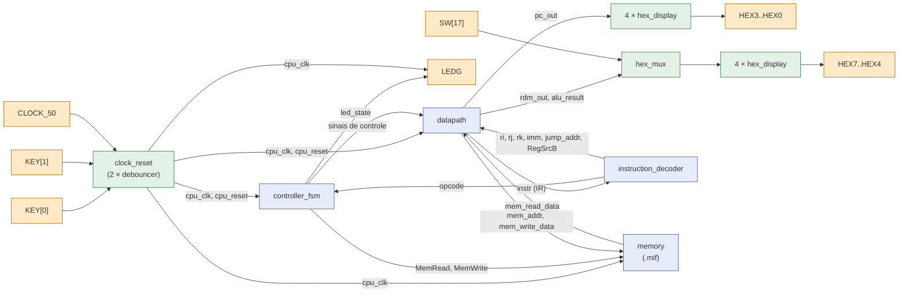
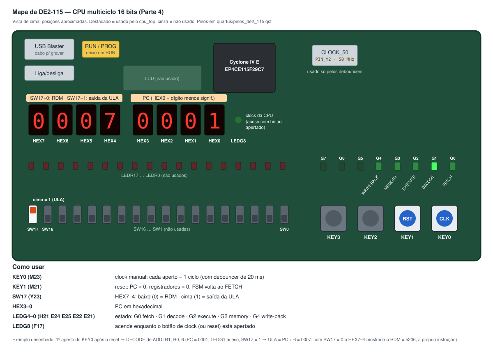

# Integração na FPGA (DE2-115)

Responsável: Parte 4 (`src/io/`, `src/top/`, `quartus/`).

## Objetivo

Ligar a CPU das partes 1 a 3 (FSM, caminho de dados, memória e decodificador) à placa DE2-115 e atender os requisitos de teste do enunciado (`docs/descricao-projeto.md`):

| Requisito do enunciado | Como foi atendido | Onde |
|---|---|---|
| Um botão controla o clock, com debouncer | `KEY[0]` → `debouncer` → `clk` da CPU. Cada aperto é um ciclo. | `src/io/debouncer.vhd`, `src/io/clock_reset.vhd` |
| HEX0–HEX3 mostram o PC | 4 instâncias de `hex_display` ligadas a `pc_out` | `src/top/cpu_top.vhd` |
| HEX4–HEX7 mostram o RDM ou a saída da ULA, escolhidos pelo SW17 | `hex_mux` (`SW17 = 0` → RDM, `1` → ULA) + 4 `hex_display` | `src/io/hex_mux.vhd` |
| LEDs verdes indicam o estado da unidade de controle | `LEDG[4:0] = led_state` (one-hot: fetch, decode, execute, memory, write-back) | `src/top/cpu_top.vhd` |
| Memória inicializada por `.mif` | generic `MIF_FILE` do `cpu_top`, repassado à `memory` | `quartus/criar_projeto.tcl` |

Além disso: `KEY[1]` é o reset e `LEDG[8]` acende enquanto o botão de clock está apertado (mostra que o debouncer reagiu).

## Visão geral

O `cpu_top` é o único arquivo que conhece todos os blocos (inversão de dependência, ver `docs/estrutura-projeto.md`). Ele não tem lógica própria: só instancia os módulos e liga as portas. Toda lógica de placa (inverter botões, filtrar quique, decodificar segmentos, escolher o que vai no display) fica em `src/io/`.



A fiação do núcleo (FSM + decodificador + datapath + memória) é a mesma do `sim/testbenches/tb_cpu.vhd`, que já tinha sido validado pelas partes 2, 3 e 5. A Parte 4 acrescenta só o que está em verde.

## Módulos

### `debouncer.vhd`: o botão vira um clock limpo

Um botão mecânico **quica**: ao ser apertado ou solto, o contato abre e fecha várias vezes durante alguns milissegundos. Como o `KEY[0]` é o próprio clock da CPU, sem filtro cada quique viraria uma borda de subida, e um aperto executaria vários ciclos.

O debouncer roda no `CLOCK_50` (50 MHz) e tem três partes:

1. **Sincronizador de 2 flip-flops.** O botão muda a qualquer momento, sem relação com o `CLOCK_50`. Se ele mudar bem na borda, o primeiro FF pode ficar metaestável (nem 0 nem 1). O segundo FF dá um ciclo inteiro para o valor se estabilizar antes de ser usado.
2. **Contador.** Enquanto a entrada sincronizada for igual ao nível estável, o contador fica em 0. Quando ela muda, o contador começa a contar; se o botão voltar antes do fim (quique), o contador zera. Só depois de `CONTAGEM` = 1 000 000 ciclos seguidos (1 000 000 × 20 ns = **20 ms**) o novo nível é aceito.
3. **Inversão.** Os `KEY` da DE2-115 são ativos em 0 (valem 0 apertados). A saída do debouncer é ativa em 1 (`1` = apertado), pronta para ser clock e reset. Assim a inversão não precisa ficar no topo.

A saída vem de um registrador, então não tem glitch: é seguro usá-la como clock. O `CONTAGEM` é um generic para o testbench poder usar um valor pequeno.

### `clock_reset.vhd`: clock e reset da CPU (e um problema de integração encontrado)

Junta dois debouncers (`KEY[0]` e `KEY[1]`) e entrega `cpu_clk` e `cpu_reset`:

```vhdl
cpu_clk   <= clk_db or reset_db;
cpu_reset <= reset_db;
```

O `or` com o reset resolve um problema que só apareceu ao integrar a memória com a placa:

- A memória (`altsyncram`) tem **leitura síncrona** e está ligada no **clock invertido** (decisão da Parte 3, seção [01](01-descricao-topologia.md)). Ela registra o endereço na **descida** do clock, ou seja, quando o botão é **solto**.
- O reset é **assíncrono**: zera o PC na hora, mas não gera borda nenhuma. A memória continua com o endereço que registrou na última vez que o `KEY[0]` foi solto.
- Resultado: depois de um reset no meio do programa, o primeiro FETCH carregava no IR a instrução do **endereço antigo**, e não a do endereço 0. No teste (`tb_cpu_top`), depois de rodar o programa até o fim e dar reset, o IR recebia `803F` (o `BEQ` do endereço 18) no lugar de `5206`.

Com o `or`, apertar o `KEY[1]` sobe o clock, o que não tem efeito porque tudo está em reset. Soltar o `KEY[1]` desce o clock junto com o fim do reset: nesse momento o PC já é 0, então a memória registra o endereço 0 e o primeiro aperto do `KEY[0]` busca `M[0]`. No power-up o problema não aparece, porque o registrador de endereço da RAM já começa em 0.

A correção ficou em `src/io/` (e não no topo nem na memória) por dois motivos: o `cpu_top` não tem lógica, e o problema é da interface com os botões, não da memória. Nenhum arquivo das partes 1 a 3 precisou mudar.

### `hex_display.vhd`: 4 bits → 7 segmentos

Tabela de 16 linhas (`with ... select`), uma por dígito de 0 a F. Os segmentos da DE2-115 são **ativos em 0** (`0` acende), na ordem `segmentos(0)` = a … `segmentos(6)` = g. As letras b e d saem minúsculas para não serem confundidas com 8 e 0. O mesmo componente é instanciado 8 vezes, uma por display (DRY).

### `hex_mux.vhd`: RDM ou ULA nos HEX4–HEX7

Mux 2:1 de 16 bits: `SW17 = 0` mostra o **RDM** (dado lido da memória) e `SW17 = 1` mostra a **saída da ULA**. A ordem segue o enunciado, que cita primeiro o RDM. A saída da ULA é combinacional, então mostra o que a ULA está calculando **no estado atual** (por exemplo, `PC + 1` no FETCH). O RDM mostra o que foi lido da memória na borda anterior.

### `cpu_top.vhd`: a composição

- As **portas** têm exatamente os nomes e larguras do `quartus/pinos_de2_115.qsf` (`CLOCK_50`, `KEY`, `SW`, `LEDG`, `HEX0`…`HEX7`), porque o Quartus associa os pinos às portas pelo nome.
- **Generics** `MIF_FILE` (programa carregado na memória) e `DEBOUNCE_CONTAGEM` (20 ms na placa, poucos ciclos na simulação).
- O PC e o dado do display são divididos em fatias de 4 bits (`pc_out(3 downto 0)` vai no HEX0, …, `pc_out(15 downto 12)` no HEX3).
- `LEDG <= cpu_clk & "000" & led_state`: LEDG4–0 = estado, LEDG7–5 apagados, LEDG8 = clock.
- `reg_dump` do datapath fica `open`: só os testbenches usam.

## Temporização de um aperto

```
              aperta KEY0          solta KEY0            aperta KEY0
cpu_clk  ______/‾‾‾‾‾‾‾‾‾‾‾‾‾‾‾‾‾‾‾‾\____________________/‾‾‾‾‾‾
               ↑                    ↓                    ↑
               borda de subida:     borda de descida:    borda de subida:
               FSM muda de estado;  memória registra o   IR/RDM capturam o
               PC, IR, A, B,        endereço (PC ou      dado lido
               ALUOut, RDM e banco  ALUOut) e começa
               são escritos         a ler
```

Por isso, olhando a placa: a cada aperto o LED de estado avança, e o PC muda no aperto que sai do FETCH. O valor da memória que aparece no RDM é o do endereço que estava montado quando o botão foi solto.

## Pinagem

Detalhada em [`quartus/pinout.md`](../../quartus/pinout.md) e desenhada em [`quartus/mapa_placa.svg`](../../quartus/mapa_placa.svg).

| Sinal | Pino | Uso |
|---|---|---|
| `CLOCK_50` | Y2 | só para os debouncers |
| `KEY[0]` | M23 | clock manual da CPU |
| `KEY[1]` | M21 | reset |
| `SW[17]` | Y23 | HEX7–4: 0 = RDM, 1 = ULA |
| `LEDG[0..4]` | E21, E22, E25, E24, H21 | fetch, decode, execute, memory, write-back |
| `LEDG[8]` | F17 | clock da CPU (aceso com o botão apertado) |
| `HEX0..HEX3` | ver `.qsf` | PC |
| `HEX4..HEX7` | ver `.qsf` | RDM ou ULA |



## Como compilar e gravar

1. Em `quartus/`: `quartus_sh -t criar_projeto.tcl` (cria o projeto com dispositivo `EP4CE115F29C7`, topo `cpu_top`, todos os `.vhd`, o `.mif` e os pinos lidos de `pinos_de2_115.qsf`). Para outro programa: `quartus_sh -t criar_projeto.tcl <nome>`.
2. Abrir `quartus/cpu_multiciclo.qpf` e compilar.
3. *Tools → Programmer* → USB-Blaster, modo JTAG → `output_files/cpu_multiciclo.sof` → Start. Chave RUN/PROG em RUN.
4. Apertar **KEY1** uma vez (reset) e avançar com **KEY0**.

Avisos esperados do Quartus: clock gerado por lógica (`cpu_clk` sai de um registrador e não de um pino de clock) e falta de restrições de timing (`.sdc`). Com um ciclo por aperto de botão, nenhum dos dois causa problema.

## Testes

### Simulação: `sim/testbenches/tb_cpu_top.vhd`

Testa o `cpu_top` inteiro **só pelos pinos**, como alguém olhando a placa, com o programa `programa_completo.mif`:

- aperta o `KEY[0]` **com quique** (3 rebotes de 40 ns antes e depois) e confere que cada aperto gera exatamente um ciclo;
- confere ciclo a ciclo a primeira instrução (`ADDI R1, R0, 6`): PC nos HEX0–3, estado nos LEDG4–0, RDM e ULA nos HEX4–7 com o SW17 nas duas posições;
- confere o LEDG8 com o botão apertado e solto;
- roda o programa até o fim e confere o PC parado em `0012`/`0013`;
- dá **reset no meio do programa** e confere que a primeira instrução é buscada de novo corretamente (o teste que pegou o problema descrito em `clock_reset`).

Resultado: `tb_cpu_top: OK`. O `tb_cpu` do grupo continua passando sem alterações.

### Na placa: roteiro

Depois de gravar e apertar o reset, compare a placa com o gabarito abaixo (gerado pela simulação do `cpu_top`). Pontos que valem mostrar na apresentação:

| Apertos | O que observar | Prova que |
|---|---|---|
| 0 → 4 | LEDs: fetch → decode → execute → write-back → fetch; PC 0000 → 0001 | FSM e ADDI |
| 1 | SW17 = 0: `5206` (a instrução lida); SW17 = 1: `0007` (PC + 6, alvo especulativo do desvio) | RDM, ULA e mux do SW17 |
| 30–31 | ST: execute com ULA = `001E` (endereço 30) e depois memory | cálculo de endereço do ST |
| 36 | LD em write-back com RDM = `0009` | o ST gravou e o LD leu de volta |
| 38 → 40 | BEQ: PC vai de `000A` para `000B`, pulando o "veneno" do endereço 10 | desvio tomado |
| 41 → 43 | BNE não tomado: PC segue em `000C` | desvio não tomado |
| 53 → 54 | BNE do laço: PC volta de `000F` para `000D` | desvio para trás |
| 69 → 71 | JMP: PC vai para `0011` | salto incondicional |
| 75 em diante | PC alterna `0012`/`0013` para sempre | fim de programa (`BEQ R0, R0, -1`) |

O PC mostrado é o valor no estado atual. No FETCH ele é o endereço da instrução que está sendo buscada; do DECODE em diante ele já foi incrementado (PC + 1).

## Alterações em arquivos de outras partes (uniformização)

- `src/datapath/datapath.vhd`: **só comentários**. As portas `alu_result` e `rdm_out` diziam `SW17 = 0` para a ULA e `SW17 = 1` para o RDM, o contrário do `quartus/pinout.md`. Valeu o `pinout.md` (ordem do enunciado). A lógica do datapath não mudou.
- `docs/especificacao/01-descricao-topologia.md`: a linha "Periféricos da placa" agora aponta para esta seção.
- `docs/especificacao/README.md`, `sim/testbenches/README.md`: incluem esta seção e o `tb_cpu_top`.
- `.gitignore`: arquivos gerados pelo Quartus e pelo ModelSim.

## Perguntas prováveis na apresentação

- **Por que não usar o `CLOCK_50` como clock da CPU e o botão como enable?** Seria o mais "correto" em projeto síncrono, mas FSM, datapath e memória não têm entrada de enable, e a decisão do grupo (a mesma do Lab05) foi usar o botão como clock. Com um ciclo por aperto, o aviso de clock gerado por lógica não causa problema.
- **Por que 20 ms?** O quique de um botão comum dura poucos milissegundos; 20 ms cobre com folga e ainda é imperceptível para quem aperta.
- **Para que servem os 2 flip-flops antes do contador?** Evitar metaestabilidade: o botão é assíncrono em relação ao `CLOCK_50`.
- **Por que o reset também gera clock?** Para a memória, que lê na descida do clock, registrar o endereço 0 depois do reset (ver `clock_reset`).
- **Por que a ULA mostra valores "estranhos" em alguns estados?** Nos estados em que a ULA não é usada (memory, write-back, jump), os seletores ficam no valor padrão da FSM e a ULA calcula algo que ninguém usa. Os valores que importam são os de FETCH, DECODE e execute.

<details>
<summary>Gabarito completo: o que a placa mostra a cada aperto do KEY0 (programa_completo.mif)</summary>

Coluna "Apertos": quantas vezes o KEY0 foi apertado depois do reset. A instrução aparece na linha do FETCH em que ela é buscada.

| Apertos | Estado (LEDG) | PC (HEX3–0) | RDM (SW17=0) | ULA (SW17=1) | Instrução |
|---|---|---|---|---|---|
| 0 | fetch | `0000` | `0000` | `0001` | ADDI R1, R0, 6 |
| 1 | decode | `0001` | `5206` | `0007` |  |
| 2 | execute | `0001` | `543D` | `0006` |  |
| 3 | write-back | `0001` | `543D` | `0001` |  |
| 4 | fetch | `0001` | `543D` | `0002` | ADDI R2, R0, -3 |
| 5 | decode | `0002` | `543D` | `FFFF` |  |
| 6 | execute | `0002` | `0650` | `FFFD` |  |
| 7 | write-back | `0002` | `0650` | `0002` |  |
| 8 | fetch | `0002` | `0650` | `0003` | ADD R3, R1, R2 |
| 9 | decode | `0003` | `0650` | `0013` |  |
| 10 | execute | `0003` | `1850` | `0003` |  |
| 11 | write-back | `0003` | `1850` | `0000` |  |
| 12 | fetch | `0003` | `1850` | `0004` | SUB R4, R1, R2 |
| 13 | decode | `0004` | `1850` | `0014` |  |
| 14 | execute | `0004` | `2A58` | `0009` |  |
| 15 | write-back | `0004` | `2A58` | `0001` |  |
| 16 | fetch | `0004` | `2A58` | `0005` | AND R5, R1, R3 |
| 17 | decode | `0005` | `2A58` | `001D` |  |
| 18 | execute | `0005` | `3C60` | `0002` |  |
| 19 | write-back | `0005` | `3C60` | `0008` |  |
| 20 | fetch | `0005` | `3C60` | `0006` | OR R6, R1, R4 |
| 21 | decode | `0006` | `3C60` | `FFE6` |  |
| 22 | execute | `0006` | `4E88` | `000F` |  |
| 23 | write-back | `0006` | `4E88` | `000F` |  |
| 24 | fetch | `0006` | `4E88` | `0007` | SLT R7, R2, R1 |
| 25 | decode | `0007` | `4E88` | `000F` |  |
| 26 | execute | `0007` | `79DD` | `0001` |  |
| 27 | write-back | `0007` | `79DD` | `000D` |  |
| 28 | fetch | `0007` | `79DD` | `0008` | ST R4, R7, 29 |
| 29 | decode | `0008` | `79DD` | `0025` |  |
| 30 | execute | `0008` | `6E1E` | `001E` |  |
| 31 | memory | `0008` | `6E1E` | `0011` |  |
| 32 | fetch | `0008` | `0009` | `0009` | LD R7, R0, 30 |
| 33 | decode | `0009` | `6E1E` | `0027` |  |
| 34 | execute | `0009` | `8F01` | `001E` |  |
| 35 | memory | `0009` | `8F01` | `000C` |  |
| 36 | write-back | `0009` | `0009` | `000C` |  |
| 37 | fetch | `0009` | `8F01` | `000A` | BEQ R7, R4, depois |
| 38 | decode | `000A` | `8F01` | `000B` |  |
| 39 | execute | `000A` | `521F` | `0000` |  |
| 40 | fetch | `000B` | `521F` | `000C` | BNE R7, R4, laco |
| 41 | decode | `000C` | `9F01` | `000D` |  |
| 42 | execute | `000C` | `5B41` | `0000` |  |
| 43 | fetch | `000C` | `5B41` | `000D` | ADDI R5, R5, 1 |
| 44 | decode | `000D` | `5B41` | `000E` |  |
| 45 | execute | `000D` | `5481` | `0003` |  |
| 46 | write-back | `000D` | `5481` | `000D` |  |
| 47 | fetch | `000D` | `5481` | `000E` | ADDI R2, R2, 1 |
| 48 | decode | `000E` | `5481` | `000F` |  |
| 49 | execute | `000E` | `943E` | `FFFE` |  |
| 50 | write-back | `000E` | `943E` | `000E` |  |
| 51 | fetch | `000E` | `943E` | `000F` | BNE R2, R0, laco |
| 52 | decode | `000F` | `943E` | `000D` |  |
| 53 | execute | `000F` | `A011` | `0002` |  |
| 54 | fetch | `000D` | `A011` | `000E` | ADDI R2, R2, 1 |
| 55 | decode | `000E` | `5481` | `000F` |  |
| 56 | execute | `000E` | `943E` | `FFFF` |  |
| 57 | write-back | `000E` | `943E` | `000E` |  |
| 58 | fetch | `000E` | `943E` | `000F` | BNE R2, R0, laco |
| 59 | decode | `000F` | `943E` | `000D` |  |
| 60 | execute | `000F` | `A011` | `0001` |  |
| 61 | fetch | `000D` | `A011` | `000E` | ADDI R2, R2, 1 |
| 62 | decode | `000E` | `5481` | `000F` |  |
| 63 | execute | `000E` | `943E` | `0000` |  |
| 64 | write-back | `000E` | `943E` | `000E` |  |
| 65 | fetch | `000E` | `943E` | `000F` | BNE R2, R0, laco |
| 66 | decode | `000F` | `943E` | `000D` |  |
| 67 | execute | `000F` | `A011` | `0000` |  |
| 68 | fetch | `000F` | `A011` | `0010` | JMP pula |
| 69 | decode | `0010` | `A011` | `0021` |  |
| 70 | execute | `0010` | `521E` | `0010` |  |
| 71 | fetch | `0011` | `521E` | `0012` | ADDI R0, R0, 9 |
| 72 | decode | `0012` | `5009` | `001B` |  |
| 73 | execute | `0012` | `803F` | `0009` |  |
| 74 | write-back | `0012` | `803F` | `0018` |  |
| 75 | fetch | `0012` | `803F` | `0013` | BEQ R0, R0, fim |
| 76 | decode | `0013` | `803F` | `0012` |  |
| 77 | execute | `0013` | `0000` | `0000` |  |
| 78 | fetch | `0012` | `0000` | `0013` | BEQ R0, R0, fim |
| 79 | decode | `0013` | `803F` | `0012` |  |
| 80 | execute | `0013` | `0000` | `0000` |  |
| 81 | fetch | `0012` | `0000` | `0013` | BEQ R0, R0, fim |
| 82 | decode | `0013` | `803F` | `0012` |  |
| 83 | execute | `0013` | `0000` | `0000` |  |
| 84 | fetch | `0012` | `0000` | `0013` | BEQ R0, R0, fim |

</details>
